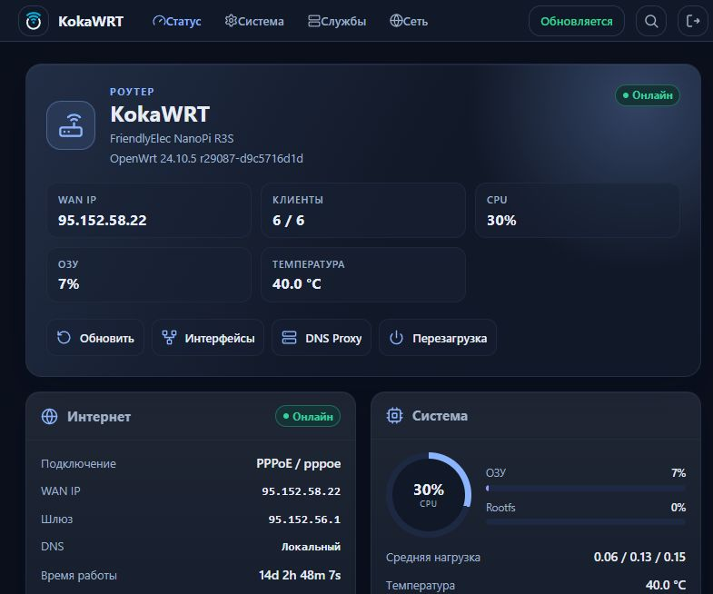

# Koka Modern for LuCI

Тёмная, аккуратная тема для LuCI на базе [luci-theme-footstrap](https://github.com/stangri/luci-theme-footstrap).
Это не форк движка: Koka — CSS-скин, небольшой дашборд и единый набор иконок,
которые ставятся поверх footstrap и легко откатываются.

> **Название в системе.** В `Система → Дизайн` тема называется **Koka**.
> Движок при этом остаётся `luci-theme-footstrap`, а путь —
> `/luci-static/footstrap`. Это сделано намеренно: скин не форкает движок,
> не ломает его обновления и откатывается одной командой.



## Что внутри

- **Тёмная палитра** navy/indigo, системные шрифты, карточки 16 px, градиентные кнопки.
- **Дашборд** в духе Keenetic OS: роутер, WAN, клиенты, CPU/ОЗУ/температура, порты,
  быстрые действия, живой график трафика. Отдельный пункт **Статус → Дашборд**;
  штатный «Обзор» не трогается.
- **Карточка «Сервисы»** — состояние DNS Proxy, dnsmasq, Zapret, Steer,
  ZeroTier, SSH и LuCI с PID/количеством процессов и быстрым переходом
  на нужную страницу.
- **Карточка «Ресурсы»** — кольцевые индикаторы CPU/температуры/памяти/флеша,
  5-минутный график, разбивка памяти по сервисам и список процессов с сортировкой
  по памяти или CPU. Данные собираются из `/proc`, внешние сервисы не нужны.
- **Стекло и живой фон**: полупрозрачные панели с размытием во всех разделах
  LuCI — карточки, меню, выпадающие списки, модальные окна; фон с плавными
  цветовыми пятнами работает на каждой странице, а не только на дашборде.
  Эффект стекла можно выключить в настройках дашборда.
- **Настройка дашборда** — кнопка **«Настроить»**: плашки можно скрывать,
  возвращать и менять местами (перетаскиванием или стрелками). Раскладка
  сохраняется в браузере.
- **Единые иконки**: меню, кнопки действий, интерфейсы, порты, Wi-Fi-сигнал.
  Линейный набор в стиле Lucide, без иконочных шрифтов.
- **Иконки интерфейсов по протоколу**: AmneziaWG/WireGuard, bridge, PPPoE,
  ZeroTier/туннели больше не выглядят одинаковым серым разъёмом.
- **Кэш-бастинг** иконок и JS, чтобы после обновления не оставались старые картинки.

## Требования

- OpenWrt 24.10+ (проверено на 24.10.5, aarch64).
- LuCI 25.x.
- Установленный `luci-theme-footstrap` (скин ставится поверх него).

## Установка

Скопируй папку на роутер, например в `/root/koka-skin`:

```sh
scp -r luci-theme-koka root@192.168.1.1:/root/koka-skin
ssh root@192.168.1.1
sh /root/koka-skin/install-koka-skin.sh
sh /root/koka-skin/install-koka-dashboard.sh
```

Затем перезагрузи страницу в браузере (`F5`).

Скрипт сам делает резервные копии с суффиксом `.bak-koka` и обновляет
токен версии LuCI, поэтому новый JS и иконки подтягиваются без ручной
очистки кэша.

## Установка из пакета

В [Releases](https://github.com/moseszz007/luci-theme-koka/releases) лежат
`luci-theme-koka_<версия>_all.ipk` (opkg) и `luci-theme-koka-<версия>.apk` (apk).
Пакет зависит от `luci-theme-footstrap`, после установки сам применяет скин
и дашборд, а при удалении возвращает сток.

```sh
opkg install luci-theme-koka_2026.11.27-r15_all.ipk
# или для apk:
cp luci-theme-koka.rsa.pub /etc/apk/keys/
apk add --allow-untrusted luci-theme-koka-2026.11.27-r15.apk
```

## Откат

```sh
sh /root/koka-skin/rollback-koka-dashboard.sh
sh /root/koka-skin/rollback-koka-skin.sh
```

Возвращает штатный `cascade.css`, `head.ut`, `interfaces.js`, иконки и пункт меню.

## Что именно меняется

| Файл | Назначение |
|---|---|
| `/www/luci-static/footstrap/cascade.css` | скин дописывается в конец, сток — в `.bak-koka` |
| `/usr/share/ucode/luci/template/themes/footstrap/partials/head.ut` | версия CSS и загрузчик `koka-icon-bust.js` |
| `/www/luci-static/footstrap/koka-icon-bust.js` | версионирует URL иконок |
| `/www/luci-static/resources/icons/*.svg` | новый набор иконок интерфейсов |
| `/www/luci-static/resources/view/network/interfaces.js` | иконка по протоколу интерфейса |
| `/www/luci-static/resources/view/status/koka_*.js` | страница дашборда |
| `/usr/share/luci/menu.d/luci-app-koka-dashboard.json` | пункт «Дашборд» |

## Производительность

Эффект стекла (`backdrop-filter`) и анимированный фон считает **браузер**, а не
роутер. На слабых телефонах размытие может быть заметным — в режиме
**«Настроить»** есть переключатель **«Стекло: вкл/выкл»**. Сам фон построен на
трёх радиальных градиентах с `transform`-анимацией, без тяжёлого blur-фильтра.

## Разработка

```sh
py -3 make-koka-icons.py       # пересобрать icons/*.svg
py -3 make-koka-interfaces.py  # пересобрать koka-interfaces.js из стокового LuCI
py -3 packages/build-packages.py --version 2026.11.27-r15
```

`koka-interfaces.js` — это стоковый `view/network/interfaces.js` с патчем
`render_iface()`: иконка выбирается по `getProtocol()`. При обновлении LuCI
файл нужно пересобрать из новой стоковой версии.

## Связанные проекты

- [luci-app-dnsproxy](https://github.com/moseszz007/luci-app-dnsproxy) — UI для dnsproxy
  с редактируемыми upstream-списками и профилями.

## Благодарности

- [luci-theme-footstrap](https://github.com/stangri/luci-theme-footstrap) — движок темы.
- [LuCI](https://github.com/openwrt/luci) — интерфейс OpenWrt.
- Иконки вдохновлены [Lucide](https://lucide.dev/).

## Лицензия

Apache-2.0. См. [LICENSE](LICENSE).
